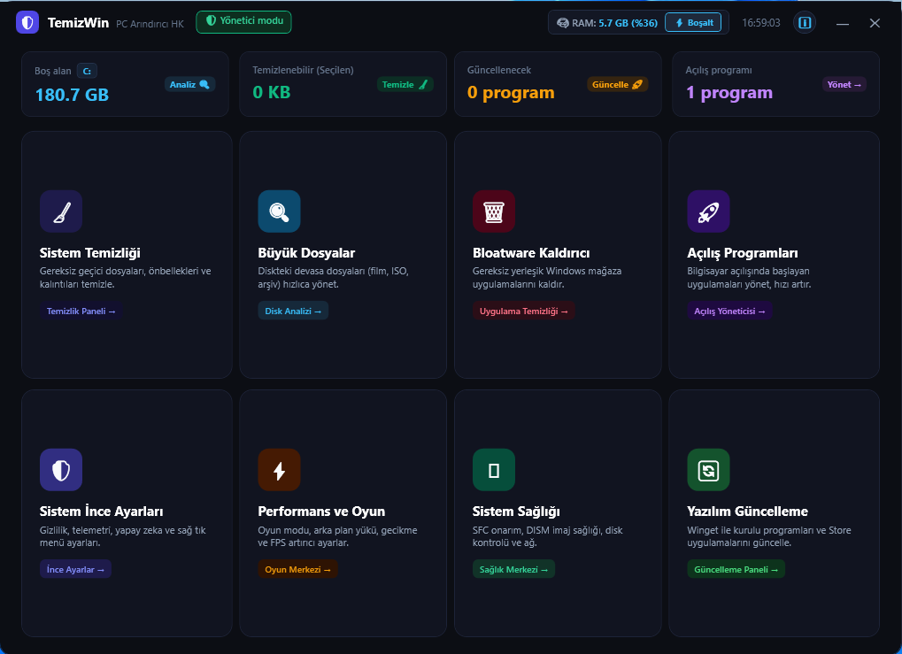

# 🚀 TemizWin - Modern Windows Bakım, Temizlik & Optimizasyon Aracı

<p align="center">
  
  
  
  
  
</p>

<p align="center">
  <b>TemizWin</b>; herhangi bir üçüncü parti kurulum, harici kütüphane veya kapalı kutu <code>.exe</code> dosyası gerektirmeyen, doğrudan Windows'un yerleşik bileşenleri (WPF XAML ve PowerShell) üzerinde çalışan, <b>%100 şeffaf, hafif ve açık kaynak kodlu</b> hepsi-bir-arada sistem bakım, temizlik ve oyun optimizasyon aracıdır.
</p>

<p align="center">
  
</p>

---

## 📑 İçindekiler / Table of Contents
- [🌟 Öne Çıkan Özellikler](#-öne-çıkan-özellikler)
- [⚡ Modüller ve Yetenekler](#-modüller-ve-yetenekler)
  - [1. Performans & Oyun Modu](#1-performans--oyun-modu)
  - [2. Sistem İnce Ayarları (Tweaks)](#2-sistem-ince-ayarları-tweaks)
  - [3. Gelişmiş Disk & Sürücü Temizliği](#3-gelişmiş-disk--sürücü-temizliği)
  - [4. Bloatware Kaldırıcı](#4-bloatware-kaldırıcı)
  - [5. Sağ Tık (Bağlam Menüsü) Yöneticisi](#5-sağ-tık-bağlam-menüsü-yöneticisi)
  - [6. Yazılım Güncelleme Motoru (Winget)](#6-yazılım-güncelleme-motoru-winget)
  - [7. Açılış Programları & Hizmetler](#7-açılış-programları--hizmetler)
  - [8. Sistem Sağlığı ve Onarım](#8-sistem-sağlığı-ve-onarım)
  - [9. Büyük Dosya Avcısı (Disk Analizörü)](#9-büyük-dosya-avcısı-disk-analizörü)
- [🚀 Hızlı Başlangıç (Nasıl Çalıştırılır?)](#-hızlı-başlangıç-nasıl-çalıştırılır)
- [🔒 Güvenlik, Gizlilik ve Felsefe](#-güvenlik-gizlilik-ve-felsefe)
- [⚖️ Lisans](#️-lisans)
- [🌐 English Summary](#-english-summary)

---

## 🌟 Öne Çıkan Özellikler

* **🛡️ Sıfır Dış Bağımlılık (No Exe):** Sistemde Python, Node.js veya harici `.exe` dosyası aramaz; saf PowerShell 5.1+ ve WPF XAML ile çalışır.
* **🎨 Modern Frameless Arayüz:** Titremeyen, şık koyu temalı (*Dark Theme*) vektörel WPF XAML arayüzü ve akıcı geçişler.
* **⚡ Aşamalı / Sayaçlı Ayar Yönetimi (Staged Batching):** Hem Performans hem İnce Ayarlar modüllerinde seçimlerinizi biriktirebilir, sayaçlı butonla (`⚡ X değişikliği uygula`) tek tıkla topluca uygulayabilir veya dilediğiniz an (`↺ Geri Al`) butonuyla anında sistem varsayılanına dönebilirsiniz.
* **🔔 Modern Yeniden Başlatma İstemi:** Yeniden başlatma gerektiren kritik ayarlar uygulandığında hangi ayarların etkilendiğini şık bir açılır kart diyalogunda gösterir ve tek tıkla güvenli yeniden başlatma sağlar.
* **🧠 Akıllı RAM Standby Purge (ISLC Yöntemi):** Aktif programların çalışma belleğini diske kovup takılma yaratan hantal yöntemler yerine, saf `NtSetSystemInformation` çağrısıyla yalnızca gereksiz disk önbelleğini boşaltır.
* **🖥️ Canlı İşlem Günlüğü (Dual Console):** Grafik arayüzün arkasında çalışan konsol penceresinde yürütülen her işlemi renkli ve satır satır görerek tam şeffaflık elde edersiniz.
* **🛡️ Dokunulmazlık Sözleşmesi:** Tarayıcı şifreleri, çerezler, açık oturumlar ve oyun kayıtları (*save dosyaları*) **kesinlikle korunur ve silinmez.**
* **⏪ Güvenli Sistem Geri Yükleme:** Kritik işlemlerden önce Windows C++ `srclient.dll` API'si üzerinden tek tıkla geri yükleme noktası oluşturur.

---

## ⚡ Modüller ve Yetenekler

### 1. Performans & Oyun Modu
Gecikmeyi (DPC latency) düşürmek, takılmaları önlemek ve maksimum FPS elde etmek için tasarlanmış 14 adet kritik sistem ayarı:
* **HAGS (Donanım Hızlandırmalı GPU Zamanlaması):** Grafik iş yükü yönetimini CPU yerine doğrudan ekran kartı donanımına devreder.
* **VBS & Bellek Bütünlüğü (HVCI):** Oyunlarda %5-%15 FPS kaybına yol açabilen sanallaştırma tabanlı güvenlik katmanını oyun odaklı optimize eder (WSL ve Sandbox desteğini bozmaz).
* **Nagle Ağ Algoritması:** `TcpAckFrequency` ve `TCPNoDelay` ayarlarını 1 yaparak TCP paket gecikmesini sıfırlar, online oyunlarda anlık ping sıçramalarını önler.
* **Doğrudan Tam Ekran (FSE / DWM Bypass):** DWM pencere yöneticisini atlayarak doğrudan donanım kare hızına erişir.
* **Pencereli Mod İyileştirmeleri:** Modern Flip Model sunum modunu zorlayarak pencereli oyunlardaki giriş gecikmesini minimize eder.
* **Game DVR & Xbox Yakalama:** Arka planda gizlice video kaydı alan ve işlemciyi yoran servisleri devre dışı bırakır.
* **Windows Game Mode:** Oyun algılandığında arka plan işlemci önceliğini oyuna tahsis eder.
* **Nihai / Yüksek Performans Güç Planı:** İşlemci çekirdek park etmeyi engeller ve tam saat hızını korur.
* **Ağ Bağdaştırıcısı Donanım Yükü (Task Offload & RSS):** Ağ paket işlemeyi CPU'dan ağ kartı yongasına devreder.
* **SysMain & Windows Search İndeksleme:** Disk okuma/yazma darboğazını ve gereksiz CPU kullanımını engeller.
* **Windows Dinamik Aydınlatma (RGB):** Çevre birim RGB gecikmelerini ve yazılım çakışmalarını önler.
* **Görsel Efektler:** Yazı tipi düzgünlüğünü (Font Smoothing / ClearType) **bozmadan** masaüstü pencere animasyon yükünü optimize eder.

### 2. Sistem İnce Ayarları (Tweaks)
70'ten fazla gelişmiş Windows ayarını kategorize edilmiş modern geçiş anahtarları ile yönetin:
* **Gizlilik ve Telemetri:** Windows tanılama verileri, DiagTrack dinleyicisi (korumalı SYSTEM görev köprüsü ile), telemetri zamanlanmış görevleri, konum erişimi, cihazımı bul, kilit ekranı önerileri ve Edge reklamları.
* **Yapay Zeka & Copilot:** Windows Copilot, Recall (Geri Çağırma), Gelişmiş Yapay Zeka özellikleri, Click to Do, AI sistem servisi, Edge/Chrome/Paint/Notepad yapay zeka entegrasyonları.
* **Arayüz & Kişiselleştirme:** Koyu Tema, Saydamlık efektleri, Sistem animasyonları, Windows Spotlight kilit ekranı, Snap düzenleri ve önerileri, Alt-Tab sekme davranışları.
* **Dosya Gezgini & Görev Çubuğu:** Klasik Windows 10/11 Sağ Tık menüsü, Dosya uzantılarını göster, Gizli dosyaları aç, Kompakt görünüm modu, Çift sürücü harflerini gizle, Giriş/Galeri/OneDrive kısayollarını kaldır.
* **Sistem & Başlat Menüsü:** Görevi Sonlandır (*End Task*) sağ tık seçeneği, Son etkin pencereye tıklama, Saat saniyeleri, Sistem tepsisi simgelerini her zaman göster, Görev çubuğunu sola hizalama, Widget'lar ve Arama stilleri.
* **Gelişmiş Geliştirici Bileşenleri:** Windows Sandbox ve WSL (Linux İçin Windows Alt Sistemi) tek tıkla etkinleştirme/kaldırma.

### 3. Gelişmiş Disk & Sürücü Temizliği
* **Eski Donanım Sürücüleri (Driver Store - pnputil):** Eski ve kullanılmayan donanım sürücü paketlerini çift aşamalı (Tarih ve Sürüm) güvenlik algoritmasıyla tarar; en güncel sürücüyü kesinlikle koruyarak eski kalıntıları siler.
* **RAM Standby Önbelleği Boşaltma:** `NtSetSystemInformation` tabanlı saf bellek temizliğiyle çalışan programları diske atmadan sistem önbelleğini serbest bırakır.
* **Sistem ve Güncelleme Artıkları:** `%TEMP%`, `SoftwareDistribution` (Windows Update önbelleği), `WinSxS` bileşen temizliği, `Windows.old` ve `$WINDOWS.~BT`.
* **Tarayıcı Önbellekleri:** Google Chrome, Microsoft Edge, Mozilla Firefox, Brave, Opera ve Opera GX (Oturumlar ve şifreler korunur).
* **Geliştirici & Uygulama Önbellekleri:** VS Code, Notion, Python/pip, VLC, Discord, Spotify, Slack ve Teams.
* **Shader & Oyun İstemcileri:** DirectX Shader, NVIDIA/AMD DXCache, Steam/Epic/EA WebCache (Oyun dosyaları ve kayıtlar asla silinmez).
* **Kırık Kısayol Avcısı:** Masaüstü ve Başlat Menüsündeki hedefi silinmiş `.lnk` dosyalarını tespit edip temizler (Ağ ve harici diskleri güvenle korur).

### 4. Bloatware Kaldırıcı
* Windows ile birlikte gelen gereksiz yerleşik paketleri (*Bing News, Hava Durumu, Clipchamp, Xbox Game Bar overlay, Cortana, Solitaire vb.*) güvenle listeler ve kaldırır.
* **Güvenli Seçim:** Sistem kararlılığını bozmayan uygulamaları tek tıkla filtreleyip seçmenizi sağlar.
* **Edge & OneDrive Özel Yönetimi:** Microsoft Edge ve OneDrive için özel bağımsız kaldırma fonksiyonları içerir.

### 5. Sağ Tık (Bağlam Menüsü) Yöneticisi
* **Hızlı Araçlar:**
  * 💻 Terminali Yönetici Olarak Aç
  * 🛡️ Sahipliği Al (*Take Ownership / icacls*)
  * 📝 Not Defteri ile Aç
  * 📋 Dosya / Klasör Yolunu Kopyala
  * 🔍 VirusTotal ile Tara
* **Klasik Menü Geçişi:** Windows 11'in hantal "Daha fazla seçenek göster" menüsünü tek tıkla doğrudan klasik Windows 10 stiline dönüştürür.
* **Özel Uygulama Ekleme:** İstediğiniz herhangi bir `.exe` programını tek tıkla sağ tık menüsüne eklemenizi veya kaldırmanızı sağlar.

### 6. Yazılım Güncelleme Motoru (Winget)
* Bilgisayarınızdaki kurulu tüm yazılımları Microsoft Winget altyapısıyla tarar.
* Çok kelimeli paket isimlerini ve sürüm karşılaştırmalarını (`< / >`) hatasız ayrıştırır.
* Seçtiğiniz güncellemeleri arka planda arayüzü dondurmadan, sıra tabanlı (FIFO kuyruğu) güvenle tamamlar.

### 7. Açılış Programları & Hizmetler
* `HKCU\Run`, `HKLM\Run`, `Wow6432Node` ve Başlangıç Klasörü altındaki tüm otomatik başlayan programları listeler.
* Windows Kayıt Defteri ikili verilerini (`StartupApproved`) bozmadan güvenle açar ve kapatır.
* Sistem açılış süresini (*Son Açılış Süresi*) rozet olarak anlık gösterir.

### 8. Sistem Sağlığı ve Onarım
* **Sistem Dosyası Onarımı:** `SFC /scannow`, `DISM /ScanHealth` ve `DISM /RestoreHealth` taramalarını tek tıkla yürütür.
* **Canlı Disk Denetimi:** `chkdsk C: /scan` ile sistemi yeniden başlatmadan salt-okunur disk denetimi yapar.
* **S.M.A.R.T. Disk Sağlığı:** SSD ve HDD fiziksel sağlık, aşınma ve sıcaklık bilgilerini raporlar.
* **DNS Profilleri:** Google DNS, Cloudflare, Quad9 veya Varsayılan servis sağlayıcı profillerini tek tıkla ağ kartınıza uygular.
* **Ağ ve Mağaza Sıfırlama:** Winsock, TCP/IP yığını, Windows Update bileşenleri ve `wsreset` araçlarını çalıştırır.

### 9. Büyük Dosya Avcısı (Disk Analizörü)
* Bağımsız bir STA Runspace iş parçacığında çalışır; taranırken arayüz kilitlenmez.
* İndirilenler, Belgeler, Masaüstü veya tüm sürücülerdeki devasa dosyaları (100 MB+, 500 MB+, 1 GB+) kategori simgeleriyle listeler.
* Dosya konumunu doğrudan açma veya tek tıkla güvenli silme imkanı tanır.

---

## 🚀 Hızlı Başlangıç (Nasıl Çalıştırılır?)

### Yöntem 1: ZIP Olarak İndirip Başlatma (En Kolayı)
1. Bu sayfadaki yeşil **`Code`** butonuna basıp **`Download ZIP`** seçeneğini tıklayın.
2. ZIP dosyasını klasöre çıkartın.
3. Klasör içindeki **`Baslat.bat`** dosyasına çift tıklayın!
4. Windows'un soracağı Yönetici İzni (*UAC*) penceresine **"Evet"** deyin.

### Yöntem 2: Git Klonlama
```bash
git clone https://github.com/hcorc/TemizWin.git
cd TemizWin
.\Baslat.bat
```

> **Not:** `Baslat.bat` dosyası, Windows'un internetten indirilen dosyalara koyduğu güvenlik blokajını (*Mark-of-the-web*) otomatik olarak kaldırır ve programı sorunsuz başlatır.

---

## 🔒 Güvenlik, Gizlilik ve Felsefe

* **%100 Açık Kaynak:** Projede hiçbir şifrelenmiş veya derlenmiş gizli ikili kod yoktur. `TemizWin.ps1` dosyasını herhangi bir metin düzenleyiciyle açıp her satırını bizzat denetleyebilirsiniz.
* **Sıfır Telemetri:** Hiçbir kişisel veri, kullanım istatistiği veya telemetri kaydı toplanmaz ve internete gönderilmez.
* **Geri Alınabilirlik:** Yapılan her ince ayar kapatılabilir ve sistem orijinal fabrika ayarlarına geri döndürülebilir.

---

## ⚖️ Lisans

Bu proje **MIT Lisansı** ile lisanslanmıştır. Detaylar için [LICENSE](LICENSE) dosyasına göz atabilirsiniz.

```text
Copyright (c) 2026 hcorc (TemizWin Project)
Licensed under the MIT License
```

---

## 🌐 English Summary

**TemizWin** is a lightweight, all-in-one, open-source Windows 10 & 11 maintenance, debloater, cleaner, and gaming optimization utility built natively with **Pure PowerShell 5.1+ and Modern WPF XAML**.

### ✨ Highlights
* **Zero Dependencies:** No `.exe`, no third-party installers required. Runs natively on Windows.
* **14 Gaming & FPS Tweaks:** HAGS, VBS optimization, Nagle latency reduction, FSE direct display mode, windowed optimizations, GameDVR toggle, network offloads, power plans.
* **Staged Batching:** Queue your tweaks with counter badges (`⚡ Apply Changes`) and instant reset (`↺ Revert`).
* **Safe Deep Cleaner:** Temp, Windows Update cache, WinSxS, DriverStore (pnputil), browser caches, dev logs, shader caches (Preserves passwords & browser logins).
* **Smart RAM Standby Purge:** Clears standby memory using native `NtSetSystemInformation` without disk paging stutter.
* **Context Menu Manager:** Classic right-click toggle, Open in Terminal (Admin), Take Ownership, Copy Path, VirusTotal and custom app integration.
* **Bloatware Remover:** Safely remove pre-installed Windows apps without breaking system dependencies.
* **Winget Software Updater:** Responsive asynchronous updater queue.
* **System Health:** SFC, DISM, CHKDSK, S.M.A.R.T. disk diagnostics, DNS profiles and network stack reset.
* **Large File Hunter:** Non-blocking multithreaded storage analyzer.
* **100% Transparent & Private:** No telemetry, fully auditable open-source code.

Run `Baslat.bat` as Administrator and enjoy a clean, fast Windows experience!
